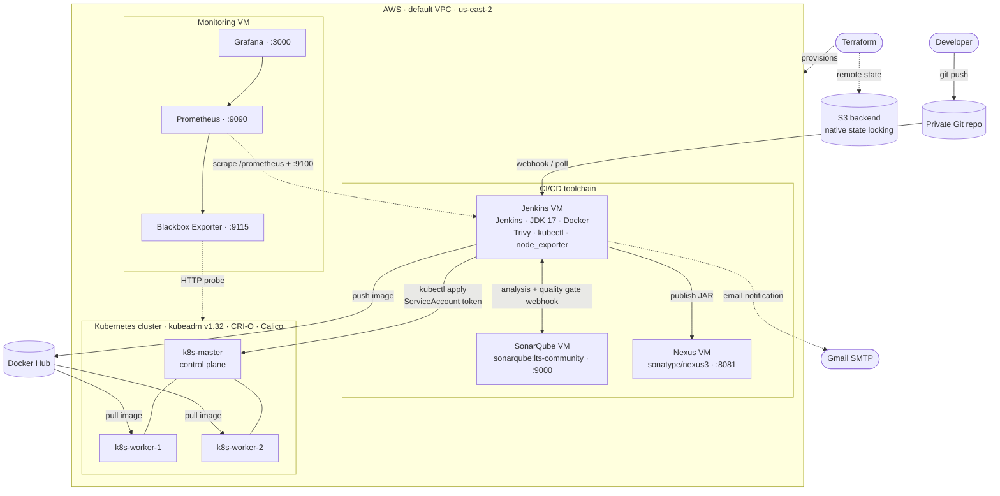
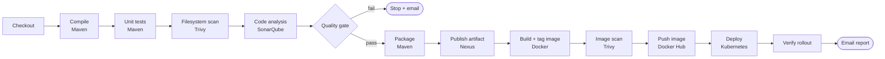

# DevSecOps CI/CD Pipeline on AWS and Kubernetes

A complete DevSecOps setup that takes a Java (Spring Boot) web app from a Git commit to a running Kubernetes deployment. Security scanning and quality checks run at every stage, and the infrastructure and the app are both monitored.

The infrastructure is built with **Terraform** on AWS. The pipeline runs in **Jenkins**: it builds with **Maven**, checks code quality with **SonarQube**, scans for vulnerabilities with **Trivy**, stores build artifacts in **Nexus**, builds and pushes images to **Docker Hub**, and deploys to a self-managed **kubeadm** cluster. **Prometheus** and **Grafana** handle monitoring.


---

## Architecture

### Infrastructure (AWS, `us-east-2`)

Terraform provisions seven Ubuntu 24.04 EC2 instances in the default VPC. Each instance is set up on first boot by a `user_data` script.



### CI/CD pipeline flow



Security runs through the whole pipeline: Trivy scans both the source tree and the built image, SonarQube's quality gate stops bad code before anything is packaged, and Jenkins deploys through a namespace-scoped ServiceAccount instead of cluster-admin credentials.

---

## Tech stack

| Area | Tools |
|---|---|
| Infrastructure as code | Terraform ≥ 1.10.5, AWS provider 5.85, S3 remote state with native locking |
| Cloud | AWS EC2, security groups, default VPC |
| Container orchestration | Kubernetes v1.32 (kubeadm), CRI-O, Calico CNI, ingress-nginx |
| CI/CD | Jenkins, Maven, JDK 17 (Eclipse Temurin) |
| Code quality and security | SonarQube (SAST and quality gate), Trivy (filesystem and image scanning) |
| Artifacts and registry | Sonatype Nexus 3 (Maven releases and snapshots), Docker Hub |
| Monitoring | Prometheus 3.2, Grafana 11.5, Blackbox Exporter, Node Exporter, Jenkins Prometheus plugin |
| Notifications | Jenkins Extended E-mail via Gmail SMTP |

---

## Repository layout

```
.
├── phase-1-infra/            # Terraform: EC2 instances, security groups, S3 backend
│   ├── extras/               # user_data scripts (K8s nodes, Jenkins, Nexus/SonarQube, monitoring)
│   └── PHASE-1.md            # cluster bootstrap and tool setup guide
├── phase-2-git/              # Private repository setup for the application
├── phase-3-cicd/             # Jenkins configuration and Kubernetes manifests
│   ├── sa.yml                # Jenkins ServiceAccount (namespace: webapps)
│   ├── role.yml              # Role scoped to the webapps namespace
│   ├── role-binding.yml      # Binds the Role to the Jenkins ServiceAccount
│   ├── secret-token.yml      # Long-lived ServiceAccount token for Jenkins
│   └── deployment-service.yml# App Deployment (2 replicas) and Service
└── phase-4-monitoring/       # Prometheus, Grafana and exporter setup guide
```

---

## Project phases

| Phase | What it covers | Guide |
|---|---|---|
| 1. Infrastructure | Terraform provisioning, kubeadm cluster bootstrap, Calico, ingress-nginx, SonarQube and Nexus containers, Jenkins install | [PHASE-1.md](phase-1-infra/PHASE-1.md) |
| 2. Source control | Private application repository | [PHASE-2.md](phase-2-git/PHASE-2.md) |
| 3. CI/CD | Jenkins plugins and tools, Trivy, SonarQube webhook, Nexus `settings.xml`, Kubernetes RBAC for Jenkins, email alerts | [PHASE-3.md](phase-3-cicd/PHASE-3.md) |
| 4. Monitoring | Prometheus service, Grafana dashboards (Blackbox 7587, Node Exporter 1860, Jenkins 9964) | [PHASE-4.md](phase-4-monitoring/PHASE-4.md) |

---

## Quick start

**Prerequisites:** an AWS account with credentials configured, Terraform ≥ 1.10.5, an S3 bucket for remote state, and an EC2 key pair named `DevSecOpProjectKeyPair` in `us-east-2`.

```bash
git clone https://github.com/Gulnazzholshy01/DevSecOpProject.git
cd DevSecOpProject/phase-1-infra

# Update backend.tf with your own S3 bucket, and providers.tf with your AWS profile
terraform init
terraform plan
terraform apply
```

Then follow the phase guides in order, starting with [PHASE-1.md](phase-1-infra/PHASE-1.md), to bootstrap the cluster and configure each tool.

To tear everything down:

```bash
terraform destroy
```

> **Cost note:** this creates seven `t2.medium` instances, which are not covered by the AWS free tier. Destroy the environment when you're done.

---

## Author

**Gulnaz Zholshy** · [GitHub](https://github.com/Gulnazzholshy01)
